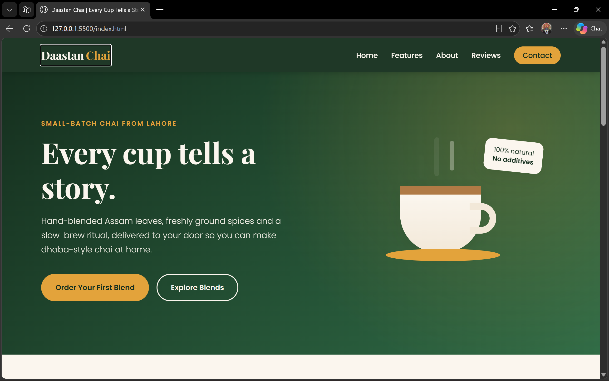
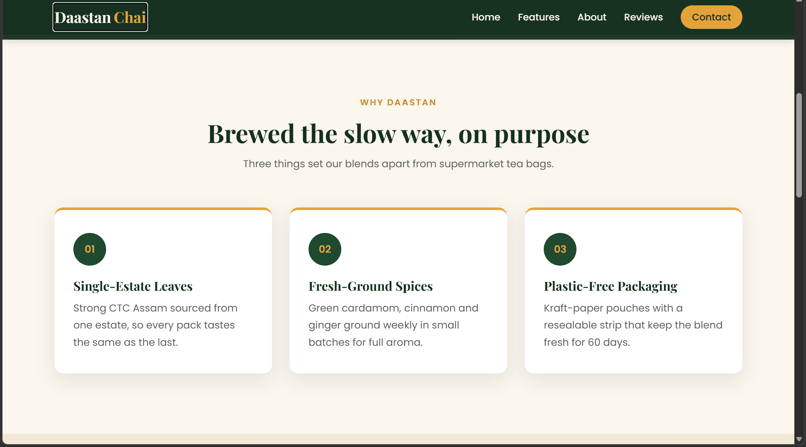
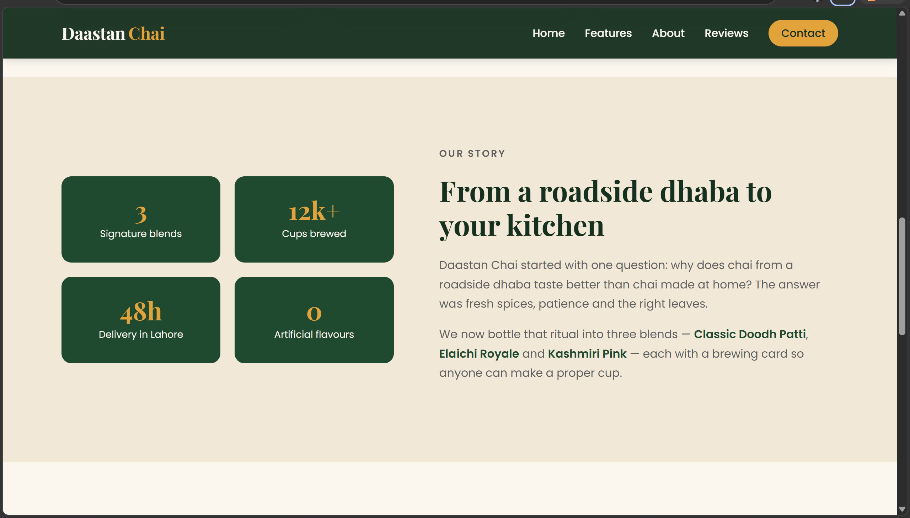
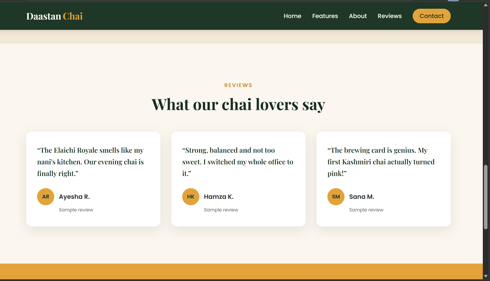
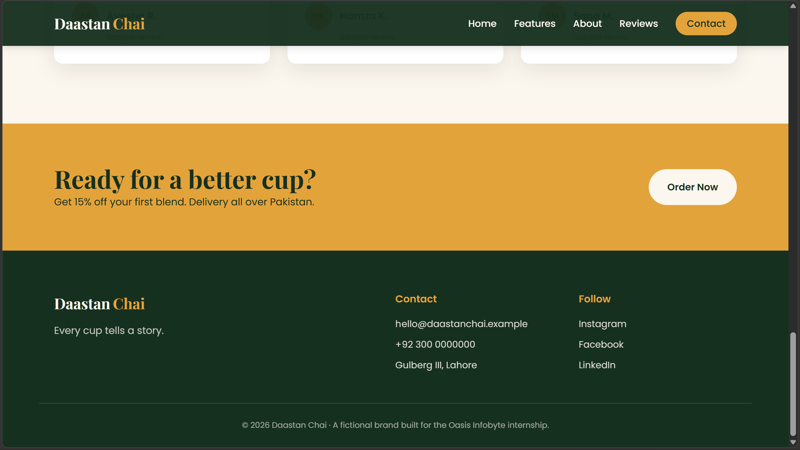
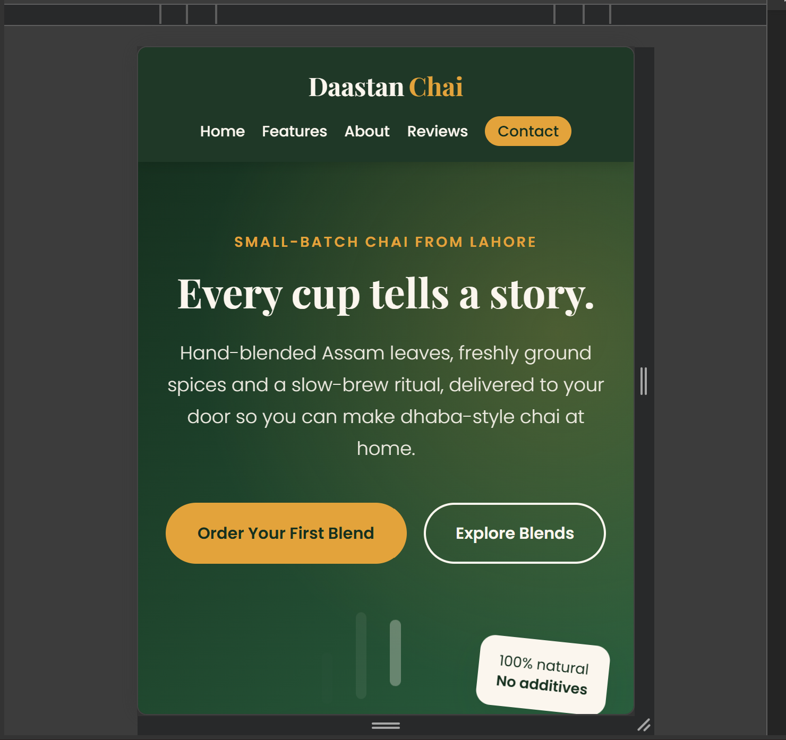

# Daastan Chai — Landing Page

**Oasis Infobyte Internship (OIBSIP) · Web Development & Designing · Level 1 · Task 1**

A responsive, static landing page for *Daastan Chai*, a fictional small-batch chai brand from Lahore. Built with **pure HTML5 and CSS3, with no JavaScript**.

## Tech Stack
- **HTML5** — semantic tags (`header`, `nav`, `main`, `section`, `article`, `blockquote`, `footer`)
- **CSS3** — custom properties, Flexbox, CSS Grid, media queries, keyframe animation
- **Google Fonts** — Playfair Display (headings) and Poppins (body)

## Feature Checklist
| Requirement | How it's done |
|---|---|
| Sticky navigation bar with at least 3 links | `position: sticky` navbar with 5 links (Home, Features, About, Reviews, Contact) |
| Hero with headline, subheadline and CTA | "Every cup tells a story." with a subheadline and two CTA buttons |
| At least 2 content sections | Features, About and Testimonials, plus a CTA band |
| Footer with contact and social links | Email, phone, address and Instagram/Facebook/LinkedIn placeholders |
| Consistent colour palette | Green, saffron and cream, defined once as CSS variables in `:root` |
| Responsive layout (Flexbox/Grid) | Grids collapse from 3 → 2 → 1 column at 900px and 640px |
| No element overlap | Global `box-sizing: border-box` and intentional padding/margin |
| At least 2 font sizes | A type scale with fluid `clamp()` headings |

**Extras:** a CSS-only chai cup with animated steam (no image files), smooth scrolling, and hover effects on buttons and cards.

## How to Run
1. Clone this repository or download the `WebDev-L1-LandingPage` folder.
2. Open `index.html` in any browser, or use the **Live Server** extension in VS Code.

## Folder Structure
```
WebDev-L1-LandingPage/
├── index.html
├── style.css
├── README.md
└── screenshots/
    ├── desktop_1_hero.png
    ├── desktop_2_features.png
    ├── desktop_3_about.png
    ├── desktop_4_reviews.png
    ├── desktop_5_footer.png
    └── mobile_1_hero.png
```

## Screenshots

### Desktop

**Hero**


**Features**


**About**


**Reviews**


**CTA & Footer**


### Mobile


## What I Learned
- Structuring a page with semantic HTML5 elements
- Keeping a design consistent with CSS custom properties
- Building responsive layouts with CSS Grid, Flexbox and media queries
- Drawing simple shapes and animations with pure CSS

## Author
**Zaka Saleem Hamdani**
Web Development & Designing Intern — Oasis Infobyte

#oasisinfobyte #webdevelopment #internship