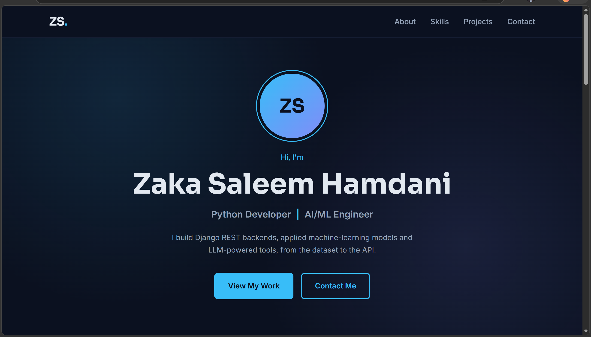
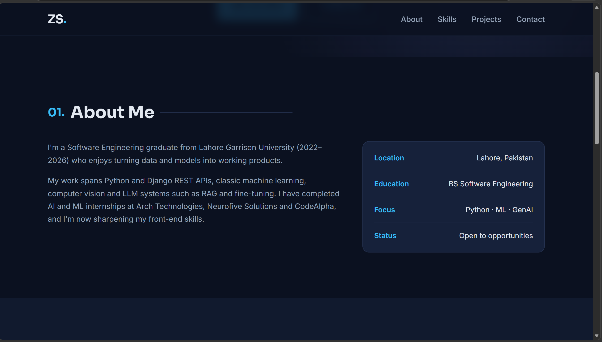
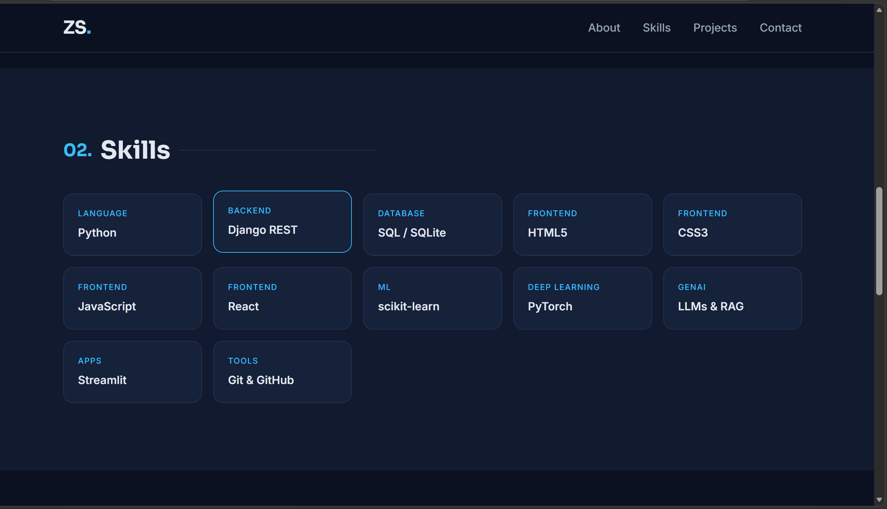
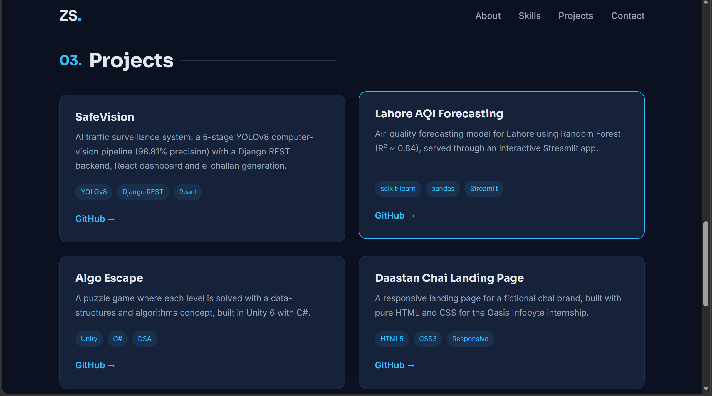
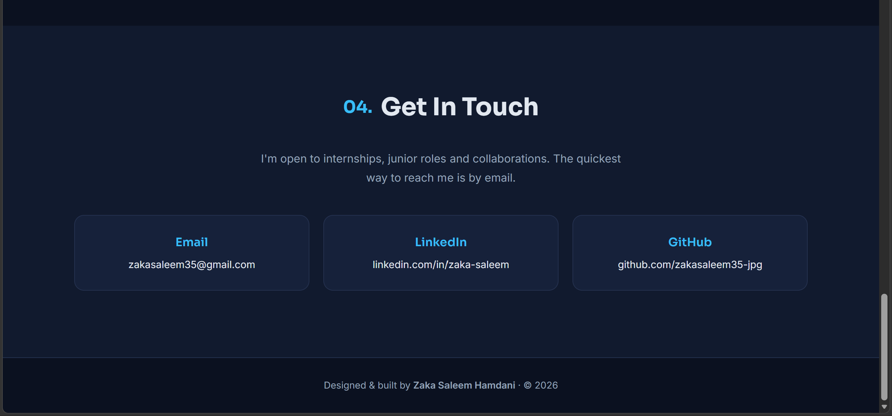
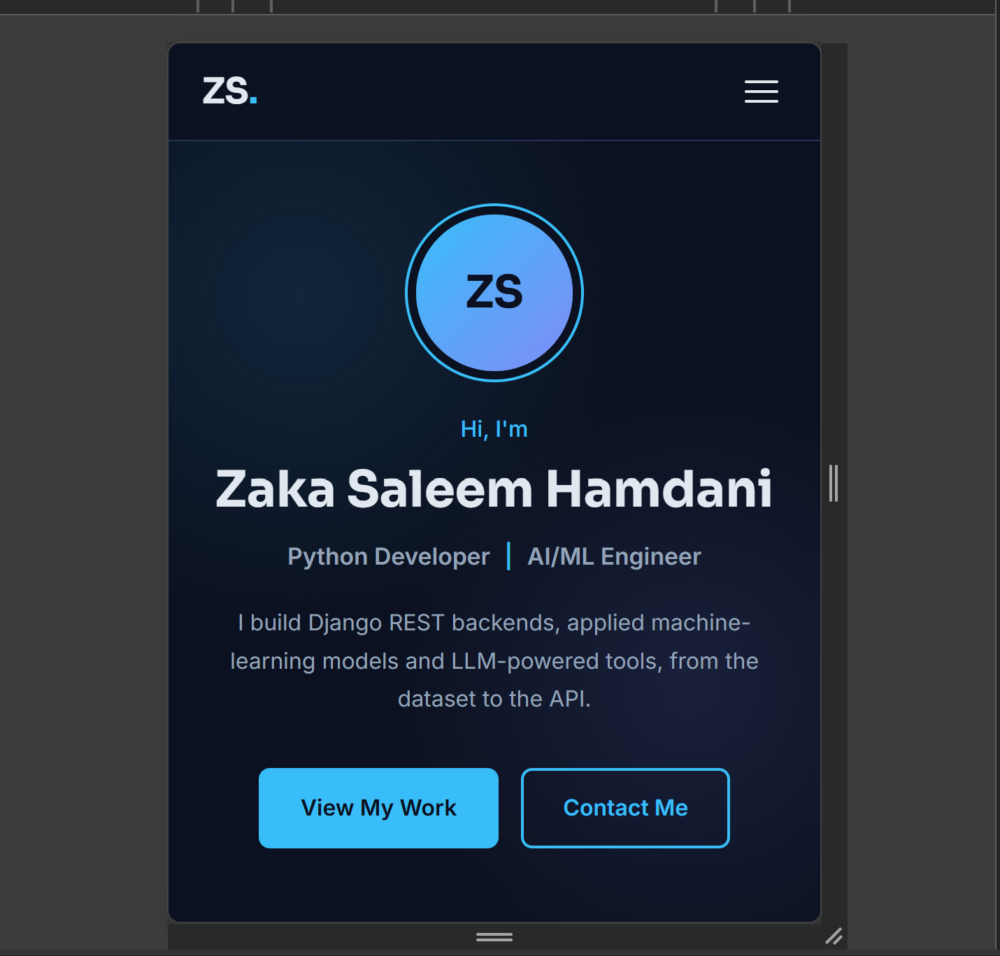
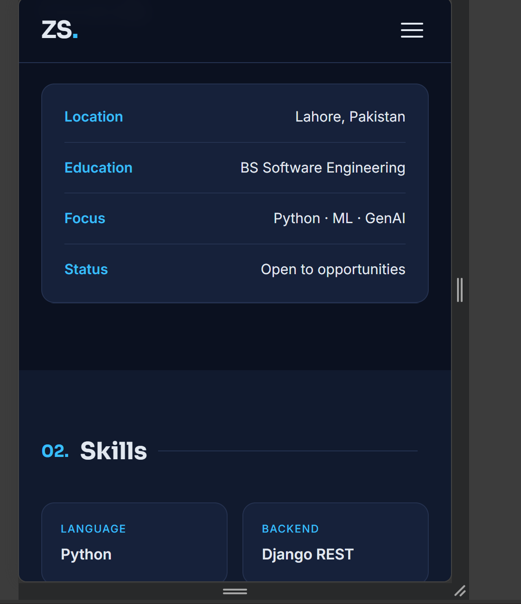

# Zaka Saleem Hamdani — Personal Portfolio

**Oasis Infobyte Internship (OIBSIP) · Web Development & Designing · Level 1 · Task 2**

A responsive personal portfolio website that works as my digital résumé, showing my background, skills, projects and contact details. Built with **HTML5, CSS3 and a small amount of vanilla JavaScript**.

## Tech Stack
- **HTML5** — semantic tags (`header`, `nav`, `main`, `section`, `article`, `footer`)
- **CSS3** — custom properties, Flexbox, CSS Grid (`auto-fill` + `minmax`), media queries, transitions
- **JavaScript (Vanilla)** — mobile hamburger menu using `addEventListener` and `classList.toggle`
- **Google Fonts** — Sora (headings) and Inter (body)

## Feature Checklist
| Requirement | How it's done |
|---|---|
| Profile/hero with name, role and avatar | Gradient "ZS" avatar, full name and role title |
| About Me section (2–3 sentences) | Short bio plus a quick-facts card (location, education, focus, status) |
| Skills section as a visual grid | 12 skill cards, each with a category label |
| At least 2 project cards | 4 cards with title, description, tech tags and GitHub link |
| Contact section | Email, LinkedIn and GitHub cards |
| Smooth scroll navigation | `scroll-behavior: smooth` with `scroll-padding-top` for the sticky navbar |
| Consistent branding | One dark colour palette and two fonts, set as CSS variables |
| Fully responsive | Layouts collapse at 860px and 640px; a hamburger menu appears on mobile |

**Extras:** sticky navbar with a frosted-glass blur, hover effects on cards and buttons, and an accessible menu button (`aria-expanded`).

## How to Run
1. Clone this repository or download the `WebDev-L1-Portfolio` folder.
2. Open `index.html` in any browser, or use the **Live Server** extension in VS Code.

## Folder Structure
```
WebDev-L1-Portfolio/
├── index.html
├── style.css
├── script.js
├── README.md
├── assets/
└── screenshots/
```

## Screenshots

### Desktop

**Hero**


**About**


**Skills**


**Projects**


**Contact**


### Mobile
<p>
  
  
</p>

## What I Learned
- Building a multi-section page with semantic HTML5
- Creating auto-adjusting grids with `repeat(auto-fill, minmax())`
- Writing my first JavaScript: selecting elements, listening for clicks and toggling classes
- Making a navigation menu that works on both desktop and mobile

## Author
**Zaka Saleem Hamdani**
Web Development & Designing Intern — Oasis Infobyte

#oasisinfobyte #webdevelopment #internship