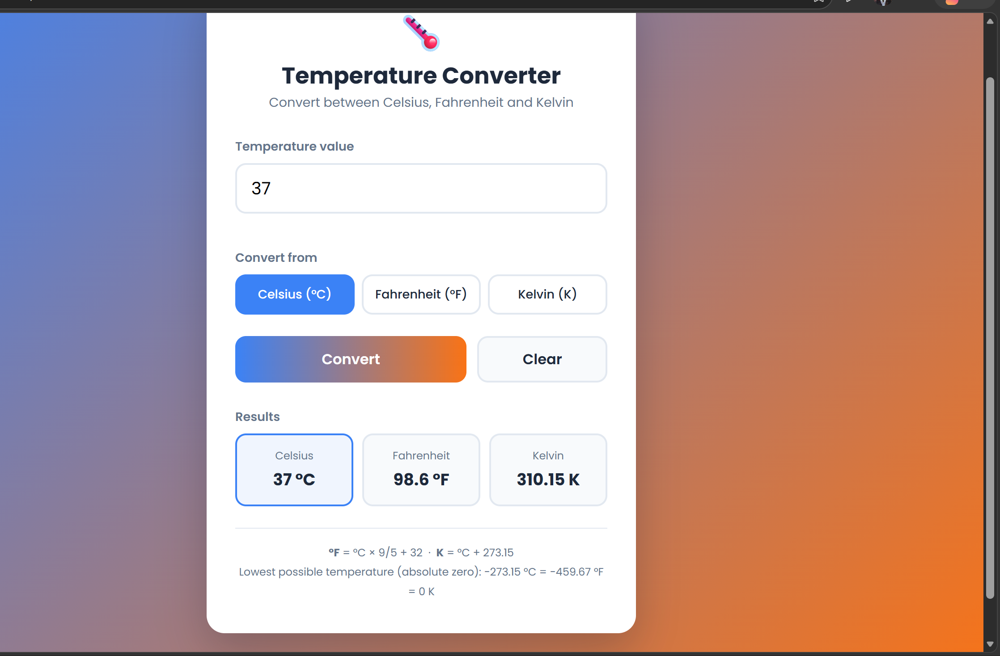
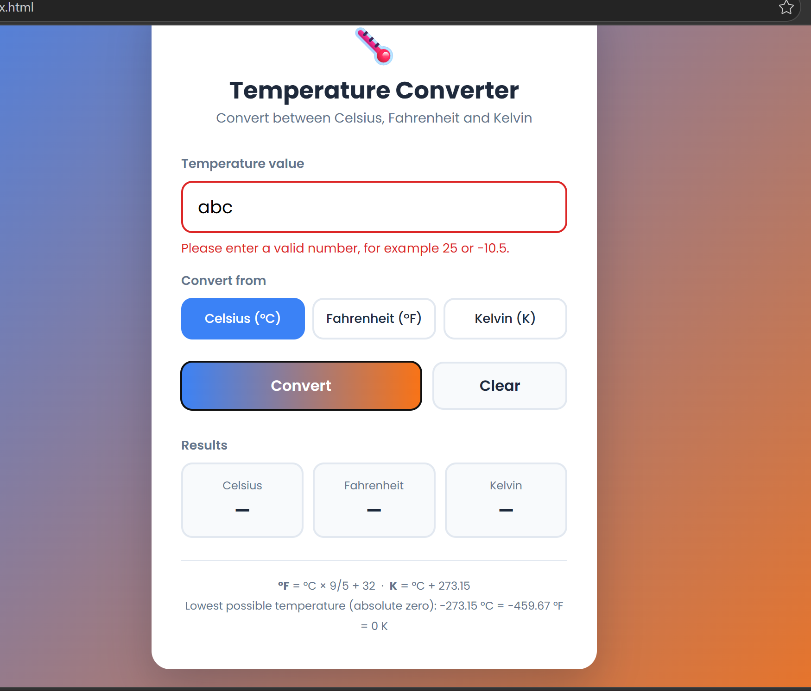
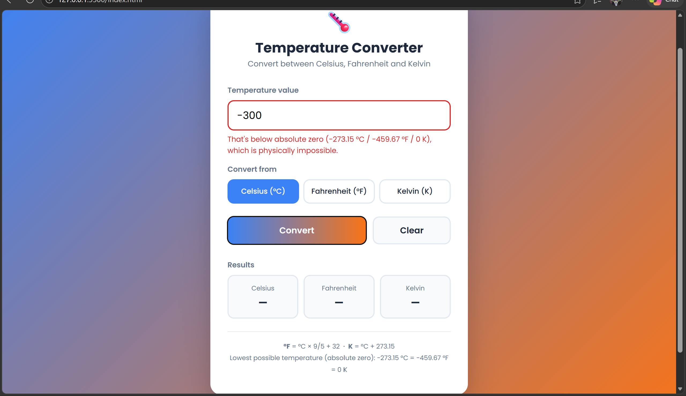
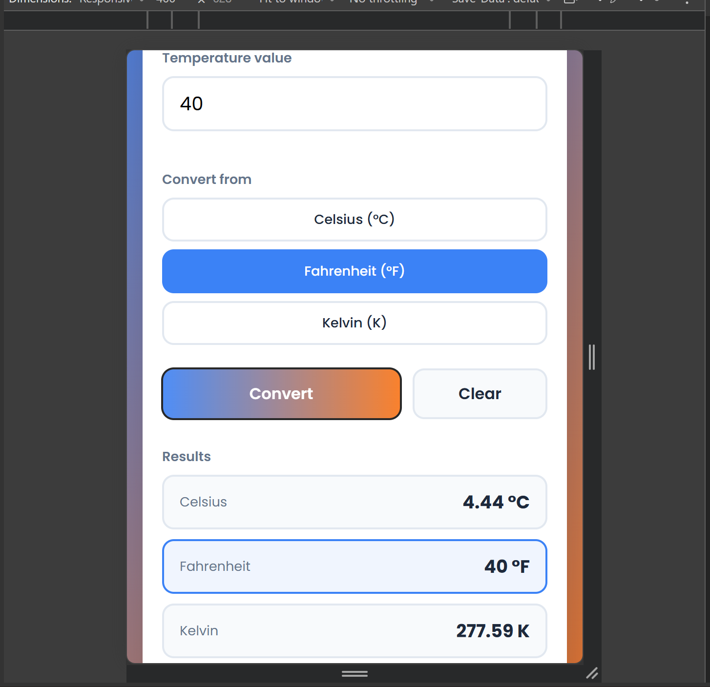

# Temperature Converter

**Oasis Infobyte Internship (OIBSIP) · Web Development & Designing · Level 1 · Task 3**

An interactive web tool that converts a temperature between **Celsius, Fahrenheit and Kelvin**, showing all three results at once. It validates input in real time and blocks values below absolute zero. Built with **HTML5, CSS3 and vanilla JavaScript**.

## Tech Stack
- **HTML5** — form, labelled input, radio-button unit selector, `aria-live` results
- **CSS3** — Flexbox, CSS Grid, custom properties, `:checked + label` styled radio pills, media queries
- **JavaScript (Vanilla)** — form handling, input validation, conversion functions, DOM updates
- **Google Fonts** — Poppins

## Feature Checklist
| Requirement | How it's done |
|---|---|
| Numeric input with validation | Non-numeric or empty input shows a clear error message and a red border |
| Unit selector for the input unit | Radio buttons for Celsius, Fahrenheit and Kelvin |
| All output units shown together | Three result cards update at once; the input unit's card is highlighted |
| Convert button | Runs the calculation on click (pressing Enter also works) |
| Result display with unit labels | Values are rounded to 2 decimals and shown with °C, °F and K |
| Absolute zero edge case | Inputs below −273.15 °C / −459.67 °F / 0 K show a friendly error |
| Clean, centred UI with labels | A single card centred on a cold-to-hot gradient background |

**Extras:** a Clear button, the error disappears as soon as you type, keyboard focus styles, and a mobile layout.

## How It Works
Every input is first converted to Celsius, and the other units are calculated from there:

| From | To Celsius |
|---|---|
| Fahrenheit | (°F − 32) × 5/9 |
| Kelvin | K − 273.15 |

| From Celsius | Formula |
|---|---|
| To Fahrenheit | °C × 9/5 + 32 |
| To Kelvin | °C + 273.15 |

## Test Cases
| Input | Unit | Result |
|---|---|---|
| 37 | °C | 98.6 °F · 310.15 K |
| 98.6 | °F | 37 °C · 310.15 K |
| −40 | °C | −40 °F · 233.15 K |
| 0 | K | −273.15 °C · −459.67 °F |
| −300 | °C | Error: below absolute zero |
| abc | any | Error: not a valid number |

## How to Run
1. Clone this repository or download the `WebDev-L1-TempConverter` folder.
2. Open `index.html` in any browser, or use the **Live Server** extension in VS Code.

## Folder Structure
```
WebDev-L1-TempConverter/
├── index.html
├── style.css
├── script.js
├── README.md
└── screenshots/
```

## Screenshots

**Conversion result**


**Invalid input**


**Below absolute zero**


**Mobile**


## What I Learned
- Handling form submission with `addEventListener` and `preventDefault()`
- Validating user input with `Number()` and `Number.isFinite()`
- Writing small, reusable conversion functions
- Updating the page with `textContent` and `classList`

## Author
**Zaka Saleem Hamdani**
Web Development & Designing Intern — Oasis Infobyte

#oasisinfobyte #webdevelopment #javascript #internship