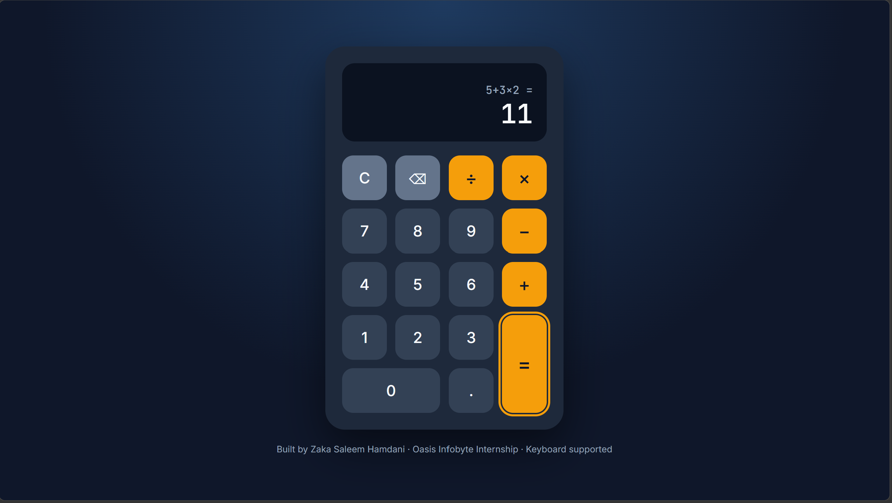
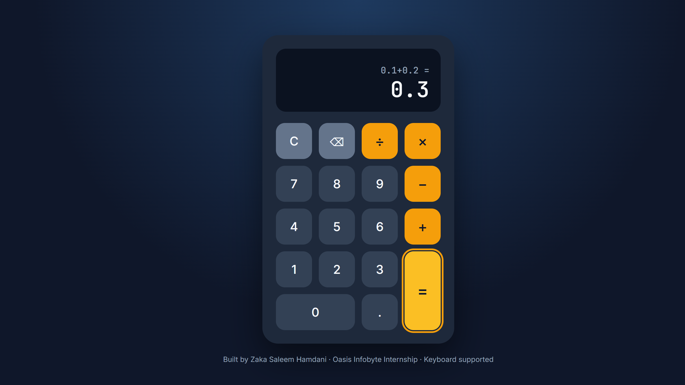
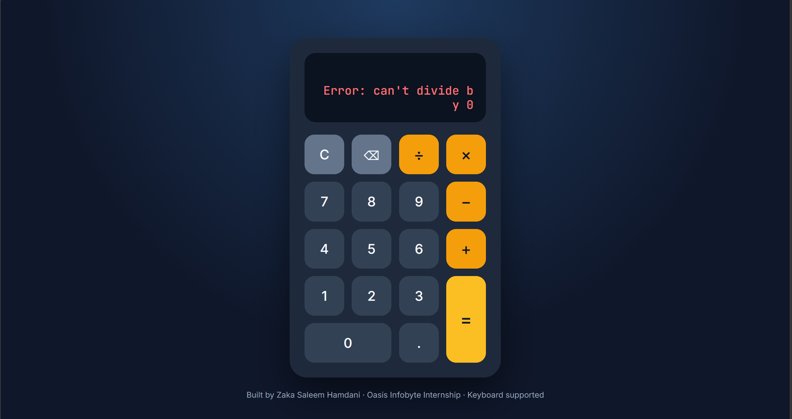
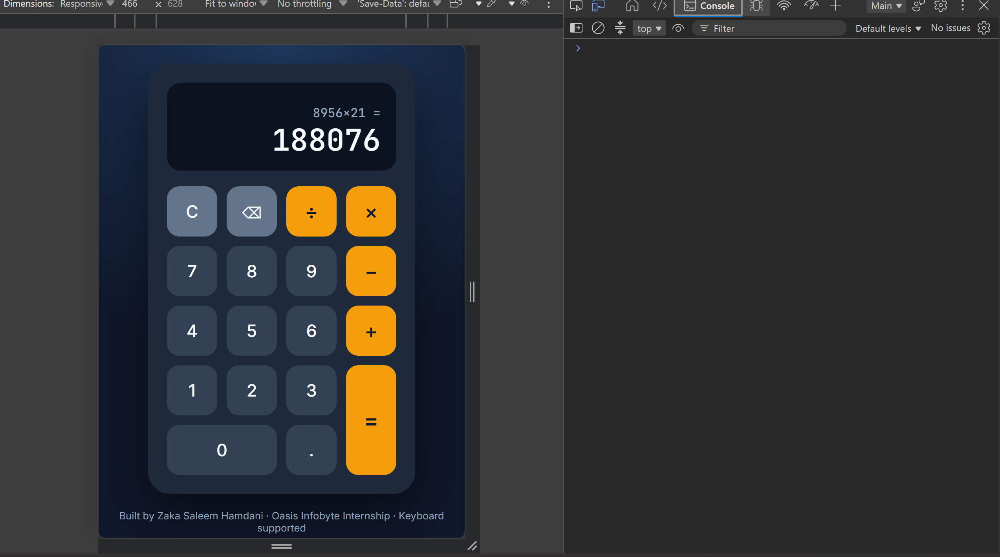

# Calculator

**Oasis Infobyte Internship (OIBSIP) · Web Development & Designing · Level 2 · Task 1**

A fully working calculator built with **HTML5, CSS3 and vanilla JavaScript**. It follows normal operator precedence, handles decimals and division by zero, and supports both mouse and keyboard input — all **without using `eval()`**.

## Tech Stack
- **HTML5** — semantic buttons with `data-*` attributes
- **CSS3** — CSS Grid keypad (`grid-row` / `grid-column: span 2`), custom properties, media queries
- **JavaScript (Vanilla)** — tokenizer, two-pass evaluator, event delegation, keyboard events

## Feature Checklist
| Requirement | How it's done |
|---|---|
| Display for input and result | Two-line display: full expression on top, current value or result below |
| Digits 0–9 and decimal point | Only one decimal point allowed per number; leading zeros removed |
| Operators + − × ÷ | Pressing a second operator replaces the first (`5+×` → `5×`) |
| Equals (=) | Evaluates the expression and shows it above the result |
| Clear (C) | Resets the calculator |
| Backspace (⌫) | Deletes the last character |
| Division by zero | Shows "Error: can't divide by 0" instead of crashing |
| Operator chaining | `5 + 3 × 2` = 11, and results can be used in the next calculation |
| CSS Grid layout | 4-column grid; "=" spans two rows and "0" spans two columns |
| Event listeners only | One delegated `click` listener; no inline `onclick` in the HTML |
| No `eval()` | Expressions are tokenized and solved with a custom evaluator |

**Extras:** keyboard support (digits, `+ - * /`, Enter, Backspace, Esc), floating-point clean-up (`0.1 + 0.2` shows `0.3`), and long results shrink to fit.

## How It Works (without eval)
1. **Tokenize** — the expression string is split into numbers and operators:
   `"5+3×2"` → `[5, "+", 3, "×", 2]`
2. **Pass 1** — multiplication and division are solved first:
   `[5, "+", 3, "×", 2]` → `[5, "+", 6]`
3. **Pass 2** — addition and subtraction are solved left to right:
   `[5, "+", 6]` → `11`

## Keyboard Shortcuts
| Key | Action |
|---|---|
| `0–9`, `.` | Enter numbers |
| `+` `-` `*` `/` | Operators |
| `Enter` or `=` | Calculate |
| `Backspace` | Delete last character |
| `Esc` or `C` | Clear |

## How to Run
1. Clone this repository or download the `WebDev-L2-Calculator` folder.
2. Open `index.html` in any browser, or use the **Live Server** extension in VS Code.

## Folder Structure
```
WebDev-L2-Calculator/
├── index.html
├── style.css
├── script.js
├── README.md
└── screenshots/
```

## Screenshots

**Operator precedence (5 + 3 × 2 = 11)**


**Decimal handling (0.1 + 0.2 = 0.3)**


**Division by zero**


**Mobile**


## What I Learned
- Building a responsive keypad with CSS Grid and spanning cells
- Writing a simple expression evaluator instead of using `eval()`
- Handling many buttons with a single delegated event listener
- Catching errors with `try...catch` and showing friendly messages

## Author
**Zaka Saleem Hamdani**
Web Development & Designing Intern — Oasis Infobyte

#oasisinfobyte #webdevelopment #javascript #internship